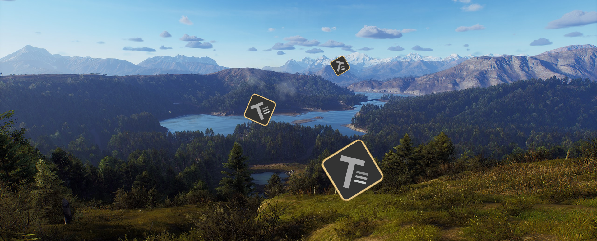
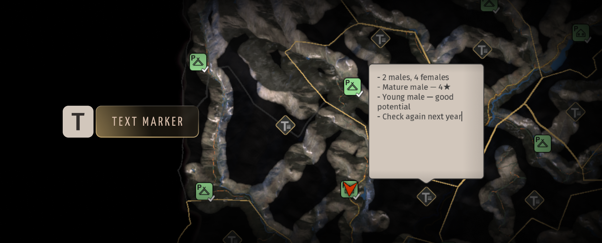

# Herd Notes — Way of the Hunter Mod

By Mahpella

Create and edit persistent text notes anywhere on the Way of the Hunter map to remember sightings, hunting plans and useful locations.

## Overview

After a long hunt, it is easy to forget where you saw a promising animal, which route you wanted to revisit or why a particular spot mattered. Herd Notes lets you **leave those reminders directly at the relevant map location**. Write and edit the note where you need it, then return to it during a later hunt.

## Download & Install

You can download the mod from my [Website](https://mahpella.com/games/way-of-the-hunter/mods/herd-notes) or [Nexus Mods](https://www.nexusmods.com/wayofthehunter/mods/36).

### Step 1. Create a backup (optional)

If you wish, copy the Saved folder to another location:  
**Win + R → %LOCALAPPDATA%\WayOfTheHunter**

### Step 2. Open the game folder

Close the game. In Steam, browse the local files for Way of the Hunter and open:  
**WayOfTheHunter\Content\Paks**

### Step 3. Install the mod

Extract the archive and copy all **.pak files into the Paks folder**, replacing older versions if necessary.  
Launch the game and load your save.

## How to Use

- Open the map and move the cursor to the location you want to remember.
- **Press T to create a note.**

- Click its text field to write or edit **up to 250 characters**; longer text wraps and can be scrolled.
- Leave the field or close the map when finished. Edits are accepted automatically and preserved by the game’s normal save.
- To delete a note, hover over its icon or card outside the text field and hold T for one second. Releasing early cancels deletion.
- Inside the text field, T types a letter. Notes do not add first-person or compass markers.

## Best Mod Combos

To make Herd Notes useful when picking up a hunt where you left off, I recommend two companion mods.

1. [Better Need Zones](https://www.nexusmods.com/wayofthehunter/mods/31) — mark a zone as a stop on your route and place a note nearby with your plan. The marker helps you reach it, while the text keeps your observations.
2. [Animal Journal](https://www.nexusmods.com/wayofthehunter/mods/34) — when you find the animals, separately record the individuals you want to follow with J through binoculars. The journal keeps their age and trophy rating, while your note keeps the location’s context. Check both before planning your next hunt.

## Feedback

If you find a bug, have suggestions for improving this mod, or have ideas for new mods, I would love to hear from you.

More useful interface and UX mods at my website: [https://mahpella.com](https://mahpella.com)

If you would like to support my work →  
[Buy Me a Coffee](https://buymeacoffee.com/mahpella) or [PayPal.me](https://paypal.me/bymahpella)
